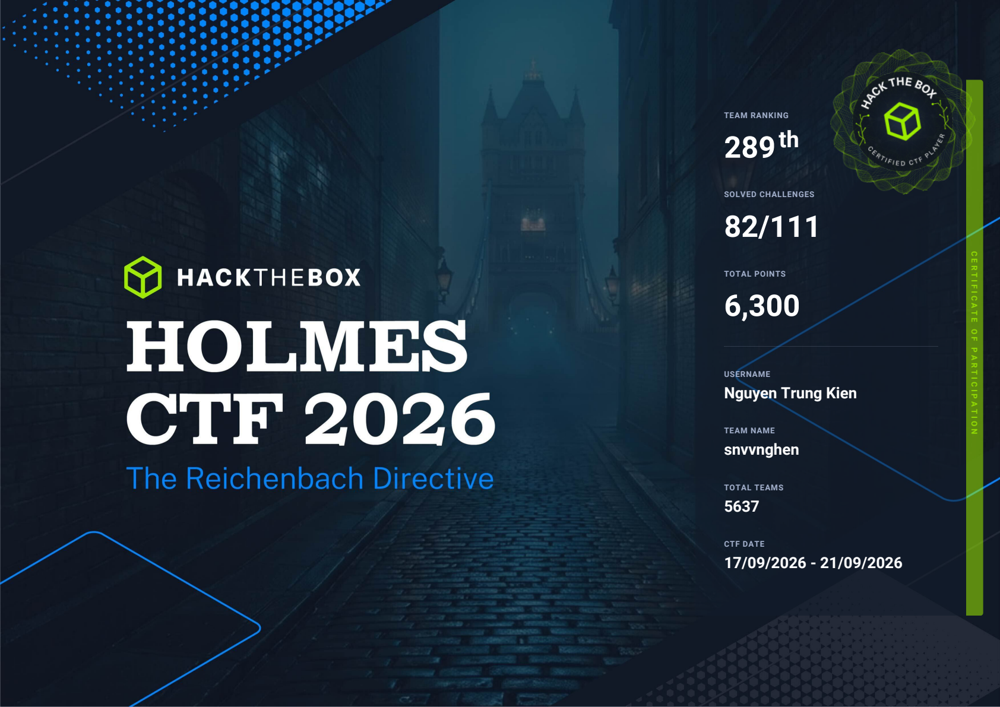

# Holmes CTF 2026 — DFIR Sherlocks & Incident Investigations

This repository contains problem statements, digital forensic evidence, custom solve/analysis scripts, and in-depth incident response **Writeups** for the digital forensics challenges (**Sherlocks**) from **Holmes CTF 2026** hosted by Hack The Box.

---

## 🏆 Certificate of Completion

  
   
  <em>🎓 Certificate of Completion — Holmes CTF 2026. Click the certificate image or <a href="./assets/Certificate-MeoBoCute.pdf">here</a> to view the original PDF.</em>

---

## 📌 Sherlocks Overview

| Challenge (Directory) | Sherlock # | Category | Status | Detailed Writeup | Key Artifacts & Solvers |
| :--- | :---: | :--- | :---: | :--- | :--- |
| **[SilentDividend](./SilentDividend/)** | `01` | Malware Analysis / Web3 Forensics | ✅ Completed (10/10) | [writeup.md](./SilentDividend/writeup.md) | `X0_Contract.sol`, `DANGER.txt` |
| **[PaperGhost](./PaperGhost/)** | `04` | Windows Triage / Event Log Forensics | ✅ Completed | [writeup.md](./PaperGhost/writeup.md) | `Triage/` (Windows Artifacts) |
| **[PoisonedBranch](./PoisonedBranch/)** | `05` | Git Supply Chain / Linux DFIR | ✅ Completed | [writeup.md](./PoisonedBranch/writeup.md) | `LOOT.zip`, `moran_id_rsa`, `decrypted_loot/` |
| **[SilentPassenger](./SilentPassenger/)** | `06` | Android & Automotive IVI Forensics | ✅ Completed (20/20) | [writeup.md](./SilentPassenger/writeup.md) | `verify_all_20.py`, `extracted/` |
| **[IronFeather](./IronFeather/)** | `07` | Drone Forensics / PX4 Autopilot ULog | ✅ Completed | [writeup.md](./IronFeather/writeup.md) | `calc_distance.py`, `find_crash.py` |

---

## 🔍 Investigation Summaries & Methodologies

### 1. Sherlock 01 — Silent Dividend (`SilentDividend`)
* **Scenario:** Dr. Watson disappears after probing mysterious extortion demands linked to the TrustSettle payment desktop app.
* **Forensic Techniques & Investigation:**
  * Unpacked and decompiled NSIS/Electron desktop binaries (`TrustSettle 1.0.0.exe`).
  * Traced background Lua script execution monitoring file system changes via Windows `FILE_NOTIFY_INFORMATION` and network beaconing via `WinHttpSendRequest`.
  * Interacted with and reverse-engineered the smart contract `X0_Contract.sol` on Ethereum/Polygon, calling `resolveState()` to recover the decryption key.
  * Inspected malicious Web3 phishing HTML templates (`BrowserProvider`), extracted fraudulent `approve()` transactions targeting `uint256.max`, and decoded coordinate flags.
* **Key Indicators & Targets:** `AUTH=NAPOLEON SETTLEMENT_REFERENCE=SR-4821`, Coordinates `51.5049,0.0348`.

---

### 2. Sherlock 04 — The False Employee (`PaperGhost`)
* **Scenario:** Cabinet Office staff Clara Voss is targeted via physical intrusion using a rogue flash drive labeled `CO-USB-0091`.
* **Forensic Techniques & Investigation:**
  * Parsed Windows Registry hives (`SOFTWARE`, `SYSTEM`, `NTUSER.DAT`) and Windows Event Logs.
  * Pinpointed the exact mount timestamp of the Lexar USB drive and payload execution of `update.exe` via UserAssist keys.
  * Uncovered covert surveillance behaviors of the C2 agent: unauthorized microphone activation (175 seconds audio recording) and webcam streaming (127 seconds capture).
  * Reconstructed exfiltrated classified documents tied to project **DIOGENES**.

---

### 3. Sherlock 05 — Backdoored Repository and Exposed Server (`PoisonedBranch`)
* **Scenario:** Government developer Tom Ainsworth is compromised via a poisoned internal dependency from a rogue open-source repository.
* **Forensic Techniques & Investigation:**
  * Audited `ticket_parser.py` source code and identified hidden backdoor module `telemetry.py` (rolling XOR decryption between `diogenes.jpg` and `calibration.bin`).
  * Extracted covert Linux ELF C2 implant from `/home/Tom/.cache/.ticket-parser/.integrity` with callback channel to `203.0.113.10:31337`.
  * Conducted a Known-Plaintext Attack against encrypted zip archive `LOOT.zip` using `bkcrack`.
  * Recovered the private SSH key belonging to threat actor Sebastian Moran and retrieved exfiltrated emergency personnel rosters.

---

### 4. Sherlock 06 — Silent Passenger (`SilentPassenger`)
* **Scenario:** An In-Vehicle Infotainment (IVI) head unit (Android Allwinner T3) is infiltrated and weaponized into a mobile covert proxy node.
* **Forensic Techniques & Investigation:**
  * Audited and decompiled privileged system package `/system/priv-app/TWCore/TWCore.apk`.
  * Analyzed rogue firmware update mechanisms utilizing MQTT broker `tcp://mqtt.car.cardoor.cn:1883` with credentials `dofun:dofun666666` and topic subscription `dofun/car/config/#`.
  * Unpacked and analyzed multi-stage malicious payloads: `jarservice-v1.12.apk` $\to$ `stage2.dex` $\to$ `stage3_sdk.jar` $\to$ C2 plugin `sh66.io`.
  * Reconstructed proprietary AES-CBC encryption routines, decrypted C2 communication endpoints and telemetry update APIs, and recovered final geolocation tracks.
* **Validation:** All 20 challenge questions independently verified via [`verify_all_20.py`](./SilentPassenger/verify_all_20.py).

---

### 5. Sherlock 07 — Mission Vault (`IronFeather`)
* **Scenario:** An autonomous surveillance quadcopter experiences catastrophic mid-air motor failure over London due to malicious MAVLink command injection.
* **Forensic Techniques & Investigation:**
  * Reverse-engineered the core flight control binary `px4` (PX4 Autopilot).
  * Extracted custom crypto routines to decrypt the encrypted flight telemetry log `flight.ulg.encrypted` and mission storage `dataman.encrypted`.
  * Processed flight sensor streams (GPS, IMU Gyro, Actuators) using custom Python parsing scripts (`calc_distance.py`, `find_crash.py`).
  * Pinpointed drop-off coordinates at Waypoint 10, ground impact on Knightsbridge, and malicious command `MAV_CMD_INJECT_FAILURE`.

---

## 💻 Tech Stack & Tooling

* **Digital Forensics:** UAC (Unix-like Artifact Collector), Registry Explorer, Event Viewer.
* **Reverse Engineering:** Ghidra, JADX, Python (`pypdfium2`, `scapy`, `pycryptodome`).
* **Cryptanalysis:** `bkcrack`, CyberChef, Web3.py.
* **Vehicle & Drone Telemetry:** PX4 ULog Tools.
